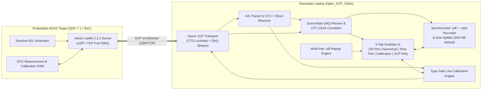

# Open_XCP_Client

[](https://github.com/Ramin1886/Open_XCP_Client/actions/workflows/ci.yml)
[](https://github.com/Ramin1886/Open_XCP_Client/actions/workflows/release.yml)

**Open_XCP_Client** is a lightweight, self-contained **XCP on Ethernet (`UDP`/`TCP`) measurement recorder, real-time 2D/time-series visualizer, `.sdf` replay analyzer, and live calibration client** engineered in Rust (`egui`/`eframe` + `tokio`).

It is purpose-built for embedded ADAS and automotive software integrating **Vector `xcplite` 2.2.2** on POSIX/QNX targets (such as Qualcomm SoC platforms running QNX 7.1), where the ASAM MCD-2 MC (`A2L`) description file is generated dynamically during target initialization and uploaded over the network.

---

## Table of Contents

- [System Overview](#system-overview)
- [Core Capabilities](#core-capabilities)
- [Getting Started](#getting-started)
- [Operator Workflow](#operator-workflow)
- [Configuration Reference (`settings.json`)](#configuration-reference-settingsjson)
- [Plot Profiles (Predefined, Reusable Measurement Views)](#plot-profiles-predefined-reusable-measurement-views)
- [SDF & MP4 File Naming Specification](#sdf--mp4-file-naming-specification)
- [Codebase Architecture](#codebase-architecture)
- [Documentation Suite](#documentation-suite)
- [Verification & Quality Assurance](#verification--quality-assurance)

---

## System Overview



`Open_XCP_Client` decouples network acquisition and disk I/O from the user interface thread:
1. **UI Thread (`eframe`/`egui`)**: Renders the top navigation bar (`Live` / `Replay` switcher, recording/replay controls, **`⚙ Settings`** button) and the 5 interactive tabs (**2D Live Plot**, **Numerical**, **Time Plot**, **Calibration**, **XCP Info**) with minimal CPU and memory overhead.
2. **Async XCP & Recording Worker (`tokio`)**: Manages socket communication, dynamic A2L upload, immediate live DAQ DTO packet demultiplexing, UTC timestamp correlation, synchronized `.sdf` + `.mp4` (H.264) recording with lockstep file-size splitting, and concurrent calibration `SHORT_DOWNLOAD` / `DOWNLOAD` requests.

---

## Core Capabilities

### 1. Dynamic Target A2L Upload & Immediate Live DAQ Streaming
- Automatically queries the running `xcplite` 2.2.2 server using `GET_ID (IDT_ASAM_UPLOAD = 4)` followed by chunked `UPLOAD` transfers to retrieve the target's A2L specification directly over Ethernet (with an optional local `.a2l` file fallback).
- Reconstructs complex C/C++ data structures from both ASAM MCD-2 MC v1.7 `TYPEDEF_STRUCTURE` / `STRUCTURE_COMPONENT` / `INSTANCE` declarations and hierarchical symbol paths (e.g., `Perception.RadarFront.targets[0].distance_m`), preserving all nested attributes and multidimensional (`MATRIX_DIM`) arrays.
- Starts live DAQ streaming immediately on connect so all visualization and numerical tabs update in real time before recording to disk.

### 2. Interactive 2D Live Plot, `(X, Y)` Signal Pairing & Ego Vehicle Configuration
- Renders a zoomable, pannable 2D ground plane in **ISO 8855 vehicle body coordinates** (`+x` forward/up, `+y` left, origin `(0, 0)` at the rear-axle center) or standard Cartesian coordinates (`+x` right, `+y` up) with a zoom-adaptive `1-2-5` metric grid (`0.1 m`..`50 m`).
- Configurable **Ego Vehicle Footprint** in **`⚙ Settings`**: parameterized by **Ego Length (`m`)** (default `4.85 m`), **Ego Width (`m`)** (default `1.90 m`), and **Rear-Axle to Center (`m`)** (default `1.425 m`).
- Interactive **`(X, Y)` Signal Pair Builder** with instant search filtering: pair any `X` and `Y` A2L signals regardless of whether `X` and `Y` are scalars or vectors (`MATRIX_DIM`) — supporting scalar-scalar, vector-vector, scalar-vector broadcast, optional valid-count truncation, and 4-corner polygon sets (`P0..P3`) across `Scatter`, `Connected Line`, `History Trail`, and `4-Corner Polygon` styles.

### 3. Synchronized `.sdf` + `.mp4` (H.264) Recording & Lockstep Size Splitting
- Stores recordings by default in `./logfile/` using matched part filenames:
  ```text
  <Prefix>_<YYYY-MM-DD_HH-MM-SSZ>_PART001.sdf
  <Prefix>_<YYYY-MM-DD_HH-MM-SSZ>_PART001.mp4
  ```
- Records 100% of incoming DAQ event samples at their native event rates into hierarchical HDF5 v2 `.sdf` files while simultaneously recording the 2D XY Plot offscreen as an H.264 `.mp4` video at a configurable frame rate (`1..30 FPS`, default `10 FPS`).
- Whenever either the `.sdf` logfile or the `.mp4` video reaches the configured split threshold (**default `500 MB`** in `⚙ Settings`), both rotate in lockstep to `PART002.sdf` and `PART002.mp4` while preserving the original recording-start UTC timestamp.

### 4. Multi-Part `.sdf` Replay Mode
- Switch the top bar from **`🟢 Live`** to **`🎞 Replay`** to load a single `.sdf` file or an entire multi-part recording (`PART001.sdf`, `PART002.sdf`, ...) in chronological order.
- Full playback transport bar with **`▶ Play` / `⏸ Pause`**, **`■ Stop`**, **Speed selector** (`0.25×`, `0.5×`, `1×`, `2×`, `5×`, `10×`, `max`), and a **continuous Time Slider** with 5-second pre-roll seeking that drives the **2D Live Plot**, **Numerical**, **Time Plot**, and **XCP Info** tabs identically to a live target.

### 5. Numerical Inspector, Rolling Time Plots, XCP Telemetry & Live Calibration
- **Numerical Tab (`Ctrl+2`)**: Filterable expandable C/C++ structure tree displaying physical values, `COMPU_VTAB` enum labels, array summaries, units, raw values, and a 1.0-second visual highlight on updated signals.
- **Time Plot Tab (`Ctrl+3`)**: Filterable signal picker (up to 12 signals) paired with a 2-column strip-chart grid featuring configurable time windows (`10 s`, `20 s`, `60 s`, `120 s`), pointer wheel time-zoom (`1..120 s`), double-click reset, and `Freeze`.
- **Calibration Tab (`Ctrl+4`)**: Searchable A2L `CHARACTERISTIC` finder and active Calibration Content watch-list table with strict data-type and `[LowerLimit, UpperLimit]` validation, transmitting updates to target memory on **`Enter`** concurrently during DAQ streaming/recording.
- **XCP Info Tab (`Ctrl+5`)**: Displays XCP connection metadata, A2L summary, and a live per-`EVENT` DAQ cycle-time telemetry table (Configured Cycle `ms`, Measured Mean/Max Cycle `ms`, Sample Count, Latest UTC Timestamp, Age `ms`).

---

## Getting Started

### Prebuilt Executables
Self-contained executables for Windows (`open_xcp_client.exe`) and Linux (`open_xcp_client`) are compiled automatically by the [Build & Release Binaries workflow](./.github/workflows/release.yml) and require no external runtime dependencies.

### Building from Source

#### Prerequisites
- Rust stable toolchain (`1.80+`)
- On Linux (Ubuntu/Debian), install standard X11/Wayland/OpenGL development headers:
  ```bash
  sudo apt-get update
  sudo apt-get install -y pkg-config libxkbcommon-dev libwayland-dev libx11-dev libxcursor-dev libxrandr-dev libxi-dev libgl1-mesa-dev
  ```

#### Compile Release Binary
```bash
cargo build --release
```
The optimized executable is produced at `target/release/open_xcp_client` (or `target\release\open_xcp_client.exe` on Windows).

#### Command-Line Flags
```bash
# Launch the desktop GUI (default)
./target/release/open_xcp_client

# Run a headless self-check of configuration, A2L parsing, and SDF recording
./target/release/open_xcp_client --headless-self-check

# Print version information
./target/release/open_xcp_client --version
```

---

## Operator Workflow

1. **Configure Target, Ego Vehicle & Recording Parameters (`⚙ Settings`)**:
   - Click **`⚙ Settings`** in the top-right navigation bar.
   - Set **Target IP Address**, **Target XCP Port** (default `5555`), and **Transport Protocol** (`UDP` or `TCP`).
   - Adjust **Logfile / Video Split Size (MB)** (default `500 MB`), **Video Frame Rate (FPS)** (default `10 FPS`), and **Ego Vehicle Geometry** (`Length`, `Width`, `Rear-Axle to Center`, `ISO 8855 Axes`).
   - *(Optional)* Enable **Built-in Mock XCPlite Server** to test live streaming, plotting, video recording, and calibration locally without hardware.
   - Click **`💾 Save Settings to JSON`**.
2. **Connect & Visualize Live Streams**:
   - Click **`Connect`** in the top bar. Live DAQ streaming starts immediately across all 5 tabs (`Ctrl+1`..`Ctrl+5`).
   - In **`📐 2D Live Plot`**, filter A2L signals in the left sidebar, pair any `X` and `Y` scalar or vector signals, choose a draw style (`Scatter`, `Connected Line`, `History Trail`, or `4-Corner Polygon`), and click **`➕ Add (X, Y) Layer to 2D Plot`**.
3. **Record Synchronized `.sdf` + `.mp4` Files**:
   - Verify the output **Folder**, **Name Prefix**, and **2D Video (`.mp4`)** FPS in the top bar, then click **`⏺ Start Recording (Ctrl+R)`**.
   - Click **`⏹ Stop Recording (Ctrl+R)`** when finished.
4. **Replay `.sdf` Recordings Offline**:
   - Switch the top bar to **`🎞 Replay`**, enter a path to one or more `.sdf` part files (or a directory containing `.sdf` parts), and click **`📂 Load .sdf`**.
   - Use **`▶ Play` / `⏸ Pause`**, **Speed** (`0.25×`..`10×`, `max`), and the **Time Slider** to scrub through the recording across all tabs.

---

## Configuration Reference (`settings.json`)

Runtime settings are stored in `./config/settings.json` (seeded from [`./config/settings.default.json`](./config/settings.default.json)).

| JSON Path | Type | Default | Description |
| :--- | :--- | :--- | :--- |
| `connection.target_ip` | `string` | `"127.0.0.1"` | IPv4 address of the target running `xcplite` |
| `connection.target_port` | `u16` | `5555` | UDP/TCP port of the `xcplite` server |
| `connection.transport` | `"Udp"` \| `"Tcp"` | `"Udp"` | XCP-on-Ethernet transport layer protocol |
| `connection.connect_timeout_ms` | `u64` | `2000` | Command response timeout in milliseconds |
| `connection.local_a2l_fallback_path` | `string` | `""` | Optional local `.a2l` path if target upload is disabled |
| `recording.default_log_folder` | `string` | `"./logfile"` | Output directory for recorded `.sdf` and `.mp4` files |
| `recording.default_file_prefix` | `string` | `"Measurement"` | Prefix used for `<Prefix>_<UTC>_PARTxxx.{sdf,mp4}` |
| `recording.max_logfile_size_mb` | `u64` | `500` | Maximum size per `.sdf` or `.mp4` part file in megabytes |
| `recording.prefer_target_utc_clock` | `bool` | `true` | Prefer target real-time UTC clock (`GET_DAQ_CLOCK`) over host clock |
| `recording.record_video_mp4` | `bool` | `true` | Record offscreen 2D XY plot as `.mp4` alongside `.sdf` |
| `recording.video_fps` | `u32` | `10` | Video frame rate in Hz (`1..=30`) |
| `recording.video_encoder` | `string` | `"libx264"` | H.264 encoder (`"libx264"`, `"h264_nvenc"`, `"h264_qsv"`, `"h264_amf"`, `"native"`) |
| `visualization.ego.length_m` | `f64` | `4.85` | Ego vehicle length in meters |
| `visualization.ego.width_m` | `f64` | `1.90` | Ego vehicle width in meters |
| `visualization.ego.rear_axle_to_center_m` | `f64` | `1.425` | Longitudinal offset (`+x`) from rear axle `(0, 0)` to vehicle center (`m`) |
| `visualization.ego.show_ego` | `bool` | `true` | Render ego vehicle outline and rear-axle crosshair |
| `visualization.ego.iso8855_axes` | `bool` | `true` | Use ISO 8855 axes (`+x` up, `+y` left) |
| `visualization.xy_layers` | `array` | `[]` | Saved 2D `(X, Y)` signal pair layer configurations |
| `visualization.time_plot_signals` | `string[]` | `[]` | Selected signals in the Time Plot strip-chart grid |
| `visualization.time_plot_window_s` | `f64` | `20.0` | Rolling time window (`1..120 s`) for Time Plot strip charts |
| `calibration.watch_list` | `string[]` | `[]` | Saved list of `CHARACTERISTIC` names in Calibration Content |
| `calibration.verify_readback` | `bool` | `true` | Verify every calibration write via immediate `SHORT_UPLOAD` readback |
| `calibration.active_cal_page` | `u8` | `0` | Active ECU/XCP calibration page (`0` = Reference, `1` = Working) |
| `ui.dark_mode` | `bool` | `true` | Enable dark engineering theme |
| `ui.enable_mock_server` | `bool` | `false` | Spawn built-in simulated QNX ADAS `xcplite` server on Connect |
| `active_profile` | `string` | `""` | Name of the plot profile in `./config/profiles/` to re-apply on startup |

---

## Plot Profiles (Predefined, Reusable Measurement Views)

A **plot profile** stores one complete measurement view — the 2D `(X, Y)` layers, the Time Plot
selection and window, the Ego geometry, the 2D viewport framing and the calibration watch-list —
as a single JSON file in `./config/profiles/<Name>.json`. Define a view once, reload it in the
next test session, or hand the file to a colleague.

The `Plot Profiles` section appears in **`⚙ Settings`** and, as a collapsed **`📁 Plot Profiles`**
header, at the top of the **`2D Live Plot`** and **`Time Plot`** sidebars:

- **`💾 Save Current View As Profile`** — write the current view under a name you type
- **`📂 Load`** / **`🔁 Update`** / **`🗑 Delete`** — apply, overwrite or remove the selected profile
- **`⤵ Import`** / **`⤴ Export`** — read or write a profile at any path, for sharing

The last profile applied is remembered as `active_profile` in `settings.json` and re-applied
automatically on the next start. Profiles reference signals by A2L name only, so loading one
against a target whose A2L lacks some of those signals applies it anyway and flags the unresolved
names with `⚠` — they are never silently dropped.

Profile files are user data and are gitignored, so no project-specific view ships with the client.
See the [Plot Profiles guide](./docs/plot_profiles.md) and
[`config/profiles/README.md`](./config/profiles/README.md) for the full schema.

---

## SDF & MP4 File Naming Specification

- **Filename Patterns**:
  - `<Prefix>_<YYYY-MM-DD_HH-MM-SSZ>_PART<NNN>.sdf`
  - `<Prefix>_<YYYY-MM-DD_HH-MM-SSZ>_PART<NNN>.mp4`
- **Internal HDF5 `.sdf` Hierarchy**:
  - `/Events/<EventName>/time_utc_s` — `float64` UTC epoch timestamp vector in seconds (`[N]`)
  - `/Events/<EventName>/time_utc_ns` — `int64` UTC epoch timestamp vector in nanoseconds (`[N]`)
  - `/Measurements/<StructGroup>/<SubStruct>/<Field>` — `float64` physical value dataset (`[N]` for scalars, `[N, D...]` for arrays).

---

## Codebase Architecture

Each source file in [`./src/`](./src/) is scoped to a single, well-defined responsibility:

| Module / Path | Scope & Responsibility |
| :--- | :--- |
| [`src/main.rs`](./src/main.rs) | Native `eframe` application bootstrap and `--headless-self-check` CLI entry point |
| [`src/lib.rs`](./src/lib.rs) | Library root exporting all core subsystems |
| [`src/config_store.rs`](./src/config_store.rs) | JSON configuration persistence (`./config/settings.json`), Ego vehicle geometry, and XY layer schema |
| [`src/plot_profile.rs`](./src/plot_profile.rs) | Named, reusable plot profiles (`./config/profiles/<Name>.json`), atomic writes, and unresolved-signal detection |
| [`src/app_state.rs`](./src/app_state.rs) | Application state controller, rolling time-series buffers, and UI $\leftrightarrow$ Worker channel orchestration |
| [`src/a2l/lexer.rs`](./src/a2l/lexer.rs) | Zero-copy tokenizer for ASAM MCD-2 MC (`A2L`) files |
| [`src/a2l/parser.rs`](./src/a2l/parser.rs) | Parser for `EVENT`, `MEASUREMENT`, `CHARACTERISTIC`, `RECORD_LAYOUT`, and `TYPEDEF_*` blocks |
| [`src/a2l/struct_resolver.rs`](./src/a2l/struct_resolver.rs) | Recursive C/C++ structure (`TYPEDEF_STRUCTURE` / `INSTANCE`) and path tree builder |
| [`src/a2l/compu_method.rs`](./src/a2l/compu_method.rs) | Physical $\leftrightarrow$ raw conversion engine (`IDENTICAL`, `LINEAR`, `RAT_FUNC`, `TAB_VERB`) |
| [`src/xcp/packet.rs`](./src/xcp/packet.rs) | XCP-on-Ethernet 4-byte header codec, CTO command builders, and DTO decoders |
| [`src/xcp/transport.rs`](./src/xcp/transport.rs) | Async UDP/TCP socket multiplexer separating CTO responses from DAQ DTO streams |
| [`src/xcp/daq_planner.rs`](./src/xcp/daq_planner.rs) | Per-event DAQ list/ODT packer (respecting the 255-entry and 255-ODT `u8` limits) and incoming DTO sample decoder |
| [`src/xcp/clock_sync.rs`](./src/xcp/clock_sync.rs) | Target `GET_DAQ_CLOCK` + 32-bit DTO timestamp rollover tracker and UTC correlator |
| [`src/xcp/client.rs`](./src/xcp/client.rs) | High-level XCP Master client (connect, A2L upload, DAQ control, concurrent calibration) |
| [`src/recording/file_namer.rs`](./src/recording/file_namer.rs) | UTC timestamp formatter and sequential `.sdf` / `.mp4` part filename generator |
| [`src/recording/size_splitter.rs`](./src/recording/size_splitter.rs) | Byte-budget tracker enforcing the configurable `max_logfile_size_mb` split threshold |
| [`src/recording/sdf_writer.rs`](./src/recording/sdf_writer.rs) | Hierarchical HDF5 v2 `.sdf` file writer, Jenkins `lookup3` checksums, and verifier reader |
| [`src/recording/video_recorder.rs`](./src/recording/video_recorder.rs) | Offscreen 2D XY plot rasterizer, `(X, Y)` signal pairing, and `.mp4` (H.264 / ISO BMFF) recorder |
| [`src/replay/mod.rs`](./src/replay/mod.rs) | Multi-part `.sdf` recording replay engine with speed scaling and 5-second pre-roll seeking |
| [`src/calibration/validator.rs`](./src/calibration/validator.rs) | Strict data-type syntax parser, A2L `[LowerLimit, UpperLimit]` checker, and raw byte encoder |
| [`src/calibration/manager.rs`](./src/calibration/manager.rs) | Calibration Content watch-list state machine and Enter-key submission handler |
| [`src/ui/axis_ticks.rs`](./src/ui/axis_ticks.rs) | Zoom-adaptive `1-2-5` metric grid step and tick formatter |
| [`src/ui/top_bar.rs`](./src/ui/top_bar.rs) | Top navigation bar with `Live`/`Replay` switch, 5-tab selector, recording/replay bar, and `⚙ Settings` button |
| [`src/ui/settings_menu.rs`](./src/ui/settings_menu.rs) | Modal settings dialog for plot profiles, target endpoint, split size (`MB`), video options, and Ego vehicle dimensions |
| [`src/ui/profile_panel.rs`](./src/ui/profile_panel.rs) | Reusable `Plot Profiles` selector (load/update/delete/save-as/import/export) and unresolved-signal warning |
| [`src/ui/plane_plot_tab.rs`](./src/ui/plane_plot_tab.rs) | Interactive 2D Live Plot canvas and filterable `(X, Y)` signal pair layer builder |
| [`src/ui/numerical_tab.rs`](./src/ui/numerical_tab.rs) | Filterable hierarchical numerical signal inspector with 1.0-second change highlighting |
| [`src/ui/time_plot_tab.rs`](./src/ui/time_plot_tab.rs) | Filterable signal picker and 2-column rolling time-series strip-chart grid |
| [`src/ui/calibration_tab.rs`](./src/ui/calibration_tab.rs) | Calibration tab UI (parameter finder, active watch-list table, type-aware input fields) |
| [`src/ui/xcp_info_tab.rs`](./src/ui/xcp_info_tab.rs) | XCP target/A2L metadata and per-event DAQ cycle-time telemetry table |
| [`src/mock_server/`](./src/mock_server/mod.rs) | Built-in Mock `xcplite` 2.2.2 UDP/TCP server and sample ADAS A2L generator |

---

## Documentation Suite

Detailed engineering documentation is located in [`./docs/`](./docs/index.md):

1. [**Documentation Portal & Index**](./docs/index.md)
2. [**System Architecture & Performance Optimization**](./docs/architecture.md)
3. [**XCP on Ethernet Protocol & Vector `xcplite` 2.2.2 Integration**](./docs/xcp_protocol_and_xcplite.md)
4. [**A2L Parsing & Complex C/C++ Structure Mapping**](./docs/a2l_structure_mapping.md)
5. [**HDF5-Based `.sdf` & `.mp4` Video Recording with Size Splitting**](./docs/sdf_file_format.md)
6. [**Calibration Guide & Data-Type Validation**](./docs/calibration_guide.md)
7. [**UI / UX Operator Manual (5 Tabs, 2D Plot & Replay)**](./docs/ui_ux_manual.md)
8. [**CI/CD Pipelines, Release Packaging & Test Coverage**](./docs/ci_cd_and_packaging.md)

---

## Verification & Quality Assurance

Run formatting checks, static analysis, and the complete integration test suite:

```bash
# Check formatting
cargo fmt --all -- --check

# Run Clippy linter with warnings denied
cargo clippy --all-targets -- -D warnings

# Run all unit, headless UI, video recording, replay, and end-to-end XCP integration tests
cargo test
```
