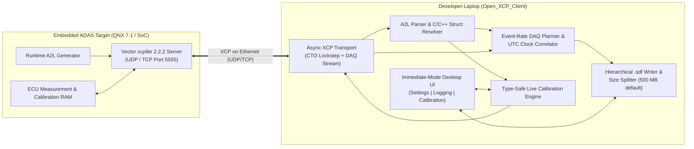

# Open_XCP_Client

[](https://github.com/Ramin1886/Open_XCP_Client/actions/workflows/ci.yml)
[](https://github.com/Ramin1886/Open_XCP_Client/actions/workflows/release.yml)

**Open_XCP_Client** is a lightweight, self-contained **XCP on Ethernet (`UDP`/`TCP`) measurement recorder and live calibration client** engineered in Rust (`egui`/`eframe` + `tokio`).

It is purpose-built for embedded ADAS and automotive software integrating **Vector `xcplite` 2.2.2** on POSIX/QNX targets (such as Qualcomm SoC platforms running QNX 7.1), where the ASAM MCD-2 MC (`A2L`) description file is generated dynamically during target initialization and uploaded over the network.

---

## Table of Contents

- [System Overview](#system-overview)
- [Core Capabilities](#core-capabilities)
- [Getting Started](#getting-started)
- [Operator Workflow](#operator-workflow)
- [Configuration Reference (`settings.json`)](#configuration-reference-settingsjson)
- [SDF File Layout & Naming Specification](#sdf-file-layout--naming-specification)
- [Codebase Architecture](#codebase-architecture)
- [Documentation Suite](#documentation-suite)
- [Verification & Quality Assurance](#verification--quality-assurance)

---

## System Overview



`Open_XCP_Client` decouples network acquisition and disk I/O from the user interface thread:
1. **UI Thread (`eframe`/`egui`)**: Renders the top navigation bar, the **`⚙ Settings`** modal, the **Logging Tab**, and the **Calibration Tab** with minimal CPU and memory overhead.
2. **Async XCP & Recording Worker (`tokio`)**: Manages socket communication, dynamic A2L upload, multi-rate DAQ DTO packet demultiplexing, UTC timestamp correlation, and concurrent calibration `SHORT_DOWNLOAD` / `DOWNLOAD` requests without interrupting active recording.

---

## Core Capabilities

### 1. Dynamic Target A2L Upload & Structure Reconstruction
- Automatically queries the running `xcplite` 2.2.2 server using `GET_ID (IDT_ASAM_UPLOAD = 4)` followed by chunked `UPLOAD` transfers to retrieve the target's A2L specification directly over Ethernet (with an optional local `.a2l` file fallback).
- Reconstructs complex C/C++ data structures from both ASAM MCD-2 MC v1.7 `TYPEDEF_STRUCTURE` / `STRUCTURE_COMPONENT` / `INSTANCE` declarations and hierarchical symbol paths (e.g., `Perception.RadarFront.targets[0].distance_m`), preserving all nested attributes and multidimensional (`MATRIX_DIM`) arrays.

### 2. Native Refresh-Rate `.sdf` Recording & UTC Time-Series
- Groups all `MEASUREMENT` variables by their native XCP `EVENT` channel (`1 ms`, `10 ms`, `100 ms`, etc.) and configures dedicated DAQ lists on the target so every signal is recorded at its true refresh rate.
- Correlates target `GET_DAQ_CLOCK` (`0xDC`) and 32-bit DTO packet timestamps into UTC time-series datasets (`time_utc_s` in `float64` seconds and `time_utc_ns` in `int64` nanoseconds), preferring the target's synchronized real-time clock when available.
- Writes self-contained, hierarchical HDF5 v2 `.sdf` files preserving the full nested structure hierarchy under `/Measurements/...` and `/Events/...`.

### 3. Configurable Automatic File Splitting
- Stores recordings by default in `./logfile/` using the naming convention:
  ```text
  <Prefix>_<YYYY-MM-DD_HH-MM-SSZ>_PART001.sdf
  ```
- Continuously tracks output file size and automatically splits recordings into sequential part files (`PART001.sdf`, `PART002.sdf`, `PART003.sdf`, ...) before exceeding the configured size threshold (**default `500 MB`**, configurable in the `⚙ Settings` menu and persisted in `./config/settings.json`).
- All parts belonging to the same recording session retain the exact UTC timestamp from the moment **Start Recording** was pressed.

### 4. Concurrent Type-Safe Live Calibration
- Dedicated **Calibration Tab** to search available A2L `CHARACTERISTIC` parameters and add them to an active Calibration Content watch-list.
- Displays live physical values converted via A2L `COMPU_METHOD` (`IDENTICAL`, `LINEAR`, `RAT_FUNC`, `TAB_VERB`) alongside type-aware input fields (`UBYTE`, `SBYTE`, `UWORD`, `SWORD`, `ULONG`, `SLONG`, `A_UINT64`, `A_INT64`, `FLOAT32_IEEE`, `FLOAT64_IEEE`, booleans, enums, and arrays).
- Validates user edits against both the underlying data type and A2L `[LowerLimit, UpperLimit]` bounds; pressing **`Enter`** immediately transmits the updated value to the target (`SHORT_DOWNLOAD` / `DOWNLOAD` with optional `SHORT_UPLOAD` readback verification) **concurrently while DAQ recording is active**.

---

## Getting Started

### Prebuilt Executables
Self-contained executables for Windows (`open_xcp_client.exe`) and Linux (`open_xcp_client`) are compiled automatically by the [Build & Release Binaries workflow](./.github/workflows/release.yml) and require no external runtime dependencies.

### Building from Source

#### Prerequisites
- Rust stable toolchain (`1.80+`)
- On Linux (Ubuntu/Debian), install standard X11/Wayland/OpenGL development headers:
  ```bash
  sudo apt-get update
  sudo apt-get install -y pkg-config libxkbcommon-dev libwayland-dev libx11-dev libxcursor-dev libxrandr-dev libxi-dev libgl1-mesa-dev
  ```

#### Compile Release Binary
```bash
cargo build --release
```
The optimized executable is produced at `target/release/open_xcp_client` (or `target\release\open_xcp_client.exe` on Windows).

#### Command-Line Flags
```bash
# Launch the desktop GUI (default)
./target/release/open_xcp_client

# Run a headless self-check of configuration, A2L parsing, and SDF recording
./target/release/open_xcp_client --self-check

# Print version information
./target/release/open_xcp_client --version
```

---

## Operator Workflow

1. **Configure Target & Recording Parameters (`⚙ Settings`)**:
   - Click **`⚙ Settings`** in the top-right navigation bar.
   - Set **Target IP Address** (e.g., `192.168.1.50`), **Target XCP Port** (default `5555`), and **Transport Protocol** (`UDP` or `TCP`).
   - Adjust **Logfile Split Size (MB)** (default `500 MB`), **Default Log Folder** (`./logfile`), and **Default Logfile Prefix** (`Measurement`).
   - *(Optional)* Enable **Built-in Mock XCPlite Server** to test recording and calibration locally against a simulated QNX ADAS target without physical hardware.
   - Click **`💾 Save Settings to JSON`** to persist settings to `./config/settings.json`.
2. **Connect & Load Target A2L**:
   - Click **`Connect`** in the top bar. The client establishes the XCP session, synchronizes the target clock, uploads and parses the A2L description, and populates both the **Logging** and **Calibration** tabs.
3. **Record Measurements (`.sdf`)**:
   - Open the **`● Logging`** tab, verify the output folder and filename prefix, and click **`⏺ Start Recording`**.
   - Inspect live structure trees, sample counters, and active part size progress. Click **`⏹ Stop Recording`** to finalize the session.
4. **Calibrate Parameters Concurrently**:
   - Switch to the **`◈ Calibration`** tab (before or during an active recording).
   - Search for any `CHARACTERISTIC` in the left finder panel and click **`+ Add`** to place it into the active Calibration Content table.
   - Edit the value in the input field and press **`Enter`** to validate and write the new value to target memory immediately.

---

## Configuration Reference (`settings.json`)

Runtime settings are stored in `./config/settings.json` (seeded from [`./config/settings.default.json`](./config/settings.default.json)). Calibration watch-lists and UI settings are never written into `.sdf` logfiles.

| JSON Path | Type | Default | Description |
| :--- | :--- | :--- | :--- |
| `connection.target_ip` | `string` | `"127.0.0.1"` | IPv4 address of the target running `xcplite` |
| `connection.target_port` | `u16` | `5555` | UDP/TCP port of the `xcplite` server |
| `connection.transport` | `"Udp"` \| `"Tcp"` | `"Udp"` | XCP-on-Ethernet transport layer protocol |
| `connection.connect_timeout_ms` | `u64` | `2000` | Command response timeout in milliseconds |
| `connection.local_a2l_fallback_path` | `string` | `""` | Optional local `.a2l` path if target upload is disabled |
| `recording.default_log_folder` | `string` | `"./logfile"` | Output directory for recorded `.sdf` files |
| `recording.default_file_prefix` | `string` | `"Measurement"` | Prefix used for `<Prefix>_<UTC>_PARTxxx.sdf` |
| `recording.max_logfile_size_mb` | `u64` | `500` | Maximum size per `.sdf` part file in megabytes (`1 MB = 1,000,000 B`) |
| `recording.prefer_target_utc_clock` | `bool` | `true` | Prefer target real-time UTC clock (`GET_DAQ_CLOCK`) over host clock |
| `calibration.watch_list` | `string[]` | `[]` | Saved list of `CHARACTERISTIC` names in Calibration Content |
| `calibration.verify_readback` | `bool` | `true` | Verify every calibration write via immediate `SHORT_UPLOAD` readback |
| `calibration.active_cal_page` | `u8` | `0` | Active ECU/XCP calibration page (`0` = Reference, `1` = Working) |
| `ui.dark_mode` | `bool` | `true` | Enable dark engineering theme |
| `ui.enable_mock_server` | `bool` | `false` | Spawn built-in simulated QNX ADAS `xcplite` server on Connect |

---

## SDF File Layout & Naming Specification

- **Filename Pattern**: `<Prefix>_<YYYY-MM-DD_HH-MM-SSZ>_PART<NNN>.sdf`
  - Example: `Measurement_2026-10-23_14-30-05Z_PART001.sdf`
- **Internal HDF5 Hierarchy**:
  - `/Events/<EventName>/time_utc_s` — `float64` UTC epoch timestamp vector in seconds (`[N]`)
  - `/Events/<EventName>/time_utc_ns` — `int64` UTC epoch timestamp vector in nanoseconds (`[N]`)
  - `/Measurements/<StructGroup>/<SubStruct>/<Field>` — `float64` physical value dataset (`[N]` for scalars, `[N, D...]` for arrays) with attributes `unit`, `a2l_symbol`, `ecu_address`, `raw_data_type`, `event_name`, and `timestamp_path`.

---

## Codebase Architecture

Each source file in [`./src/`](./src/) is scoped to a single, well-defined responsibility:

| Module / Path | Scope & Responsibility |
| :--- | :--- |
| [`src/main.rs`](./src/main.rs) | Native `eframe` application bootstrap and `--self-check` CLI entry point |
| [`src/lib.rs`](./src/lib.rs) | Library root exporting all core subsystems |
| [`src/config_store.rs`](./src/config_store.rs) | JSON configuration persistence (`./config/settings.json`) and schema validation |
| [`src/app_state.rs`](./src/app_state.rs) | Application state controller and non-blocking UI $\leftrightarrow$ Worker channel orchestration |
| [`src/a2l/lexer.rs`](./src/a2l/lexer.rs) | Zero-copy tokenizer for ASAM MCD-2 MC (`A2L`) files |
| [`src/a2l/parser.rs`](./src/a2l/parser.rs) | Parser for `EVENT`, `MEASUREMENT`, `CHARACTERISTIC`, `RECORD_LAYOUT`, and `TYPEDEF_*` blocks |
| [`src/a2l/struct_resolver.rs`](./src/a2l/struct_resolver.rs) | Recursive C/C++ structure (`TYPEDEF_STRUCTURE` / `INSTANCE`) and path tree builder |
| [`src/a2l/compu_method.rs`](./src/a2l/compu_method.rs) | Physical $\leftrightarrow$ raw conversion engine (`IDENTICAL`, `LINEAR`, `RAT_FUNC`, `TAB_VERB`) |
| [`src/xcp/packet.rs`](./src/xcp/packet.rs) | XCP-on-Ethernet 4-byte header codec, CTO command builders, and DTO decoders |
| [`src/xcp/transport.rs`](./src/xcp/transport.rs) | Async UDP/TCP socket multiplexer separating CTO responses from DAQ DTO streams |
| [`src/xcp/daq_planner.rs`](./src/xcp/daq_planner.rs) | Per-event DAQ list/ODT packer and incoming DTO sample decoder |
| [`src/xcp/clock_sync.rs`](./src/xcp/clock_sync.rs) | Target `GET_DAQ_CLOCK` + 32-bit DTO timestamp rollover tracker and UTC correlator |
| [`src/xcp/client.rs`](./src/xcp/client.rs) | High-level XCP Master client (connect, A2L upload, DAQ control, concurrent calibration) |
| [`src/recording/file_namer.rs`](./src/recording/file_namer.rs) | UTC timestamp formatter and sequential part filename generator |
| [`src/recording/size_splitter.rs`](./src/recording/size_splitter.rs) | Byte-budget tracker enforcing the configurable `max_logfile_size_mb` split threshold |
| [`src/recording/sdf_writer.rs`](./src/recording/sdf_writer.rs) | Hierarchical HDF5 v2 `.sdf` file writer, Jenkins `lookup3` checksums, and verifier reader |
| [`src/calibration/validator.rs`](./src/calibration/validator.rs) | Strict data-type syntax parser, A2L `[LowerLimit, UpperLimit]` checker, and raw byte encoder |
| [`src/calibration/manager.rs`](./src/calibration/manager.rs) | Calibration Content watch-list state machine and Enter-key submission handler |
| [`src/ui/top_bar.rs`](./src/ui/top_bar.rs) | Top navigation bar with tab switcher, connection indicator, and `⚙ Settings` button |
| [`src/ui/settings_menu.rs`](./src/ui/settings_menu.rs) | Modal settings dialog for target endpoint, split size (`MB`), and defaults |
| [`src/ui/logging_tab.rs`](./src/ui/logging_tab.rs) | Logging tab UI (Start/Stop toggle, folder/prefix inputs, split progress, structure tree) |
| [`src/ui/calibration_tab.rs`](./src/ui/calibration_tab.rs) | Calibration tab UI (parameter finder, active watch-list table, type-aware input fields) |
| [`src/mock_server/`](./src/mock_server/mod.rs) | Built-in Mock `xcplite` 2.2.2 UDP/TCP server and sample ADAS A2L generator |

---

## Documentation Suite

Detailed engineering documentation is located in [`./docs/`](./docs/index.md):

1. [**Documentation Portal & Index**](./docs/index.md)
2. [**System Architecture & Performance Optimization**](./docs/architecture.md)
3. [**XCP on Ethernet Protocol & Vector `xcplite` 2.2.2 Integration**](./docs/xcp_protocol_and_xcplite.md)
4. [**A2L Parsing & Complex C/C++ Structure Mapping**](./docs/a2l_structure_mapping.md)
5. [**HDF5-Based `.sdf` File Format & Configurable Size Splitting**](./docs/sdf_file_format.md)
6. [**Calibration Guide & Data-Type Validation**](./docs/calibration_guide.md)
7. [**UI / UX Operator Manual**](./docs/ui_ux_manual.md)
8. [**CI/CD Pipelines, Release Packaging & Test Coverage**](./docs/ci_cd_and_packaging.md)

---

## Verification & Quality Assurance

Run formatting checks, static analysis, and the complete integration test suite:

```bash
# Check formatting
cargo fmt --all -- --check

# Run Clippy linter with warnings denied
cargo clippy --all-targets -- -D warnings

# Run all unit, headless UI, and end-to-end XCP integration tests
cargo test
```
