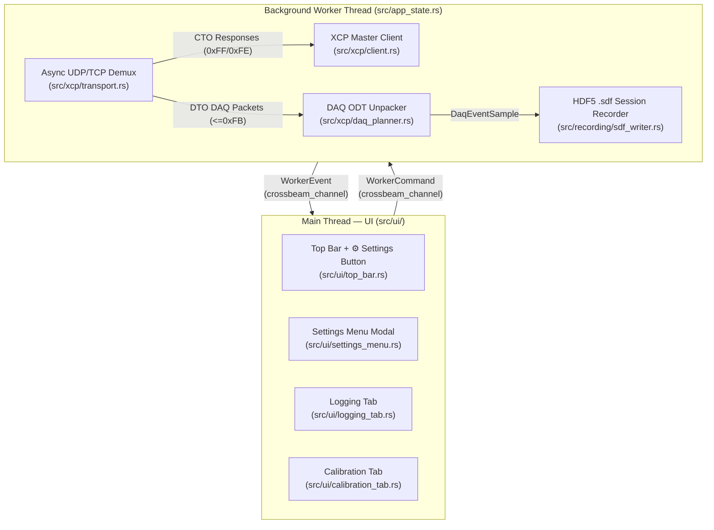

# System Architecture & Performance Optimization

[← Back to Documentation Index](./index.md)

## Overview

**Open_XCP_Client** is architected to achieve minimal CPU and RAM usage on developer laptops while sustaining high-frequency multi-rate XCP DAQ recording and concurrent interactive calibration.

---

## Strictly Scoped Module Responsibilities

1. **Configuration Layer ([`src/config_store.rs`](../src/config_store.rs))**:
   - Reads and writes `./config/settings.json` (falling back to `./config/settings.default.json`).
   - Validates IP, port, folder, prefix, and `max_logfile_size_mb` (default `500 MB`).
   - Keeps user workspace preferences strictly in JSON so `.sdf` files contain pure measurement data for cloud ingestion.
2. **A2L Layer ([`src/a2l/`](../src/a2l/mod.rs))**:
   - Zero-copy lexical scanner ([`lexer.rs`](../src/a2l/lexer.rs)) avoids unnecessary heap allocations when tokenizing multi-megabyte A2L files.
   - Recursive structure expander ([`struct_resolver.rs`](../src/a2l/struct_resolver.rs)) flattens `INSTANCE` / `TYPEDEF_STRUCTURE` trees into concrete memory addresses while preserving the nested hierarchy in `StructTreeNode`.
3. **XCP Layer ([`src/xcp/`](../src/xcp/mod.rs))**:
   - Single-threaded `tokio` runtime handles non-blocking UDP/TCP I/O ([`transport.rs`](../src/xcp/transport.rs)).
   - Incoming packets are immediately split into two dedicated queues:
     - `cto_rx` for command responses (`0xFF` / `0xFE`), enabling sub-millisecond calibration reads/writes.
     - `daq_rx` for streaming DTO DAQ packets (`0x00..=0xFB`), processed continuously without locking the CTO path.
4. **Recording Layer ([`src/recording/`](../src/recording/mod.rs))**:
   - Accumulates time-correlated samples per XCP Event channel and flushes contiguous HDF5 v2 datasets before the active file reaches `max_logfile_size_mb` ([`size_splitter.rs`](../src/recording/size_splitter.rs)).
5. **UI Layer ([`src/ui/`](../src/ui/mod.rs))**:
   - Uses `egui`/`eframe` in reactive mode: when idle, the UI sleeps until user interaction; during active recording, it repaints telemetry at a capped 20 Hz (`50 ms` interval) to keep GPU/CPU utilization near zero.

---

## Next Steps
- [XCP Protocol & Vector `xcplite` 2.2.2 Integration →](./xcp_protocol_and_xcplite.md)
- [HDF5-Based `.sdf` File Format →](./sdf_file_format.md)
